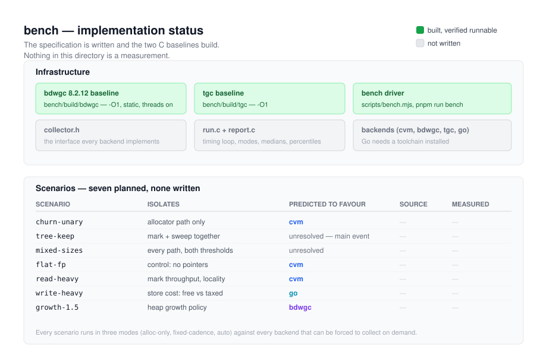
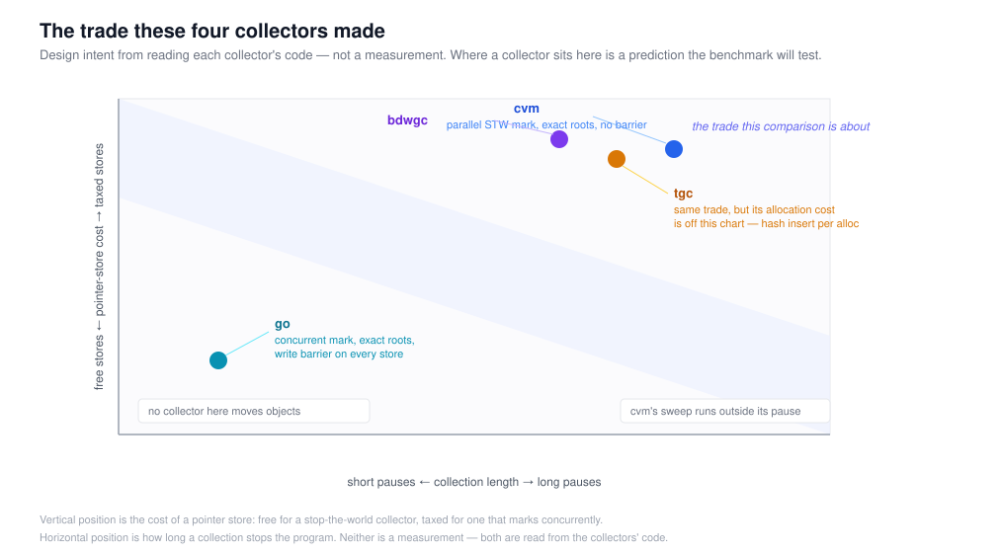
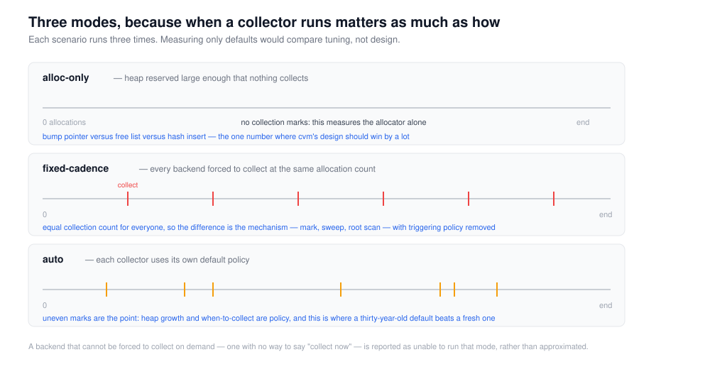

# bench — where this stands, and what it will measure

**Status: no measurements exist yet.** The specification is written
([BENCH.md](BENCH.md)), the two C baselines build, and the harness plus the
seven scenarios do not exist. Nothing in this directory is a result.

That sentence is at the top deliberately. A benchmark directory is a place
where a number written early gets quoted for a long time, and the only
defence is saying plainly which numbers exist.



## What exists, precisely

| Piece | State | Where |
|---|---|---|
| Specification | written | [BENCH.md](BENCH.md) |
| bdwgc 8.2.12 baseline | **built and verified runnable** | `bench/build/bdwgc/.libs/libgc.a` |
| tgc baseline | **built and verified runnable** | `bench/build/tgc/tgc.o` |
| scenario harness | not written | `bench/harness/` |
| collector interface | not written | `bench/harness/collector.h` |
| 7 scenarios | not written | `bench/scenarios/` |
| backends (cvm/bdwgc/tgc) | not written | `bench/backends/` |
| Go backend | not written; needs a toolchain | `bench/go/` |
| results | none | `bench/results/` |

"Built and verified runnable" means a smoke program linked against both and
ran, not merely that the build exited zero:

```
bdwgc: alloc ok, gc_no=2 heap=65536
tgc:   alloc ok, nitems=1 nslots=5
```

and bdwgc's generated `Makefile` confirms `-O1` reached `CFLAGS`.

## How to run it

```
pnpm run bench:build     # build the baselines (and scenarios, once they exist)
pnpm run bench           # build, then measure
pnpm run bench:quick     # 3 repetitions instead of 7
```

`bench/build/` is ignored; `bench/results/` is tracked and contains only
runs that measured something.

## The four collectors, and what each one is



Read the axes as design intent rather than as measurement: the horizontal is
how long a collection stops the program, the vertical is what a pointer
store costs. Those two are the trade this whole comparison is about, and
they move together — a collector buys short pauses by taxing stores.

| | Marking | Reachability | Moves objects | The trade it made |
|---|---|---|---|---|
| **cvm** | stop-the-world, **parallel** | **exact** | no | long pauses, free stores, no root scanning |
| **bdwgc** | stop-the-world | conservative | no | long pauses, free stores, robustness to a frontend with wrong stack maps |
| **tgc** | stop-the-world | conservative | no | as above, plus heavy per-allocation and per-collection bookkeeping |
| **go** | **concurrent**, write barrier | exact | no | short pauses, taxed stores, plus its own scheduler |

Three facts below the table that decide how the numbers may be read, and
each is checked rather than assumed:

**tgc is a floor, not a competitor.** It inserts every allocation into an
open-addressed hash table (`tgc_add_ptr`, load factor 0.9), scans roots with
`setjmp` and a stack walk, and its sweep walks the whole table and
`realloc`s a free array. A cvm that fails to beat it by a wide margin has a
problem. It is here to establish the floor.

**Nobody moves objects.** Not cvm, not bdwgc, not go, and not the Commix
reference this project ports from — verified by searching the entire
reference tree for evacuation, forwarding, relocation or compaction code
and finding none. So the fragmentation scenario measures allocation policy
and sweep efficiency. It cannot show what a compacting collector would do,
because there is none here.

**Go's numbers are not a verdict on Go.** Its collector is concurrent by
design, so its pauses should beat a stop-the-world collector's and its
throughput should suffer for it. A cvm win on `write-heavy` is Go paying for
short pauses, which is the trade working as intended.

## What will be measured, and in what mode

Each scenario runs in three modes, because a collector's speed depends more
on *when* it collects than on how fast it collects. Measuring only defaults
compares tuning.



Seven scenarios for the first pass. The predictions are recorded so that
being wrong is informative — a result matching a prediction is weak
evidence, one contradicting it is worth a paragraph.

| # | Scenario | What it isolates | Predicted to favour |
|---|---|---|---|
| 1 | `churn-unary` | bump allocation versus free list versus hash insert | cvm |
| 2 | `tree-keep` | marking and sweeping together, live set worth the name | unresolved — the main event |
| 3 | `mixed-sizes` | every allocation path, sizes across both cvm thresholds | unresolved |
| 4 | `flat-fp` | the control: almost no pointers, so nothing to mark | cvm |
| 5 | `read-heavy` | mark throughput and locality, mutation cost removed | cvm |
| 6 | `write-heavy` | pointer-store cost; free for STW, taxed for Go | go |
| 7 | `growth-1.5` | heap-growth policy against a live set growing at 1.49 | bdwgc |

Scenario 7 has a checkable prediction attached: cvm's heap doubles below
128 MiB and multiplies by √2 (≈1.414) above it, so a live set growing at
1.49 should outpace the heap past that threshold, and collections per
megabyte allocated should rise. If they do not, the policy is not firing as
written.

## What the results will look like

Each record carries the date, the machine, and the full flag set for every
backend, because a number missing any of the three is not a result. The
metrics per scenario are throughput, pause behaviour (maximum and p99), space
(peak RSS ÷ live set), and each collector's own accounting.

Two things about pause reporting that must be in the output or the numbers
are misleading:

- **cvm's pause excludes the sweep.** Marking, nullifying and the sweep's
  setup happen with the world stopped; the sweep itself runs after it
  resumes and is paid for by whoever allocates next. A collector that sweeps
  inside the stop would be compared unfairly otherwise.
- **The current pause figure is slightly optimistic**, and the size of the
  error scales with the log level: the world is released a few statements
  after the measured duration ends, so the counter update and the log write
  happen inside the stop but outside the measurement. The fix is a small
  reordering, recorded as task t39 in the plan.

## Where this is going

The next pieces, in the order they unblock each other:

1. `bench/harness/collector.h` — the interface every backend implements.
2. `bench/harness/run.c` + `report.c` — the timing loop, the three modes,
   the medians and percentiles.
3. `bench/backends/backend_{cvm,bdwgc,tgc}.c` — three implementations of
   that interface, each with its own allocation-counter cross-check.
4. `bench/scenarios/` — the seven workloads, one source each, linked once
   per backend so the workload cannot drift between them.
5. The Go module, once a toolchain is installed.

Per `BENCH.md` §9, none of this will say anything about a real workload,
about tail latency when the heap cannot grow, or about Windows.
