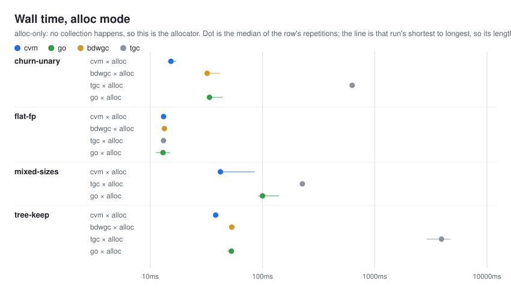
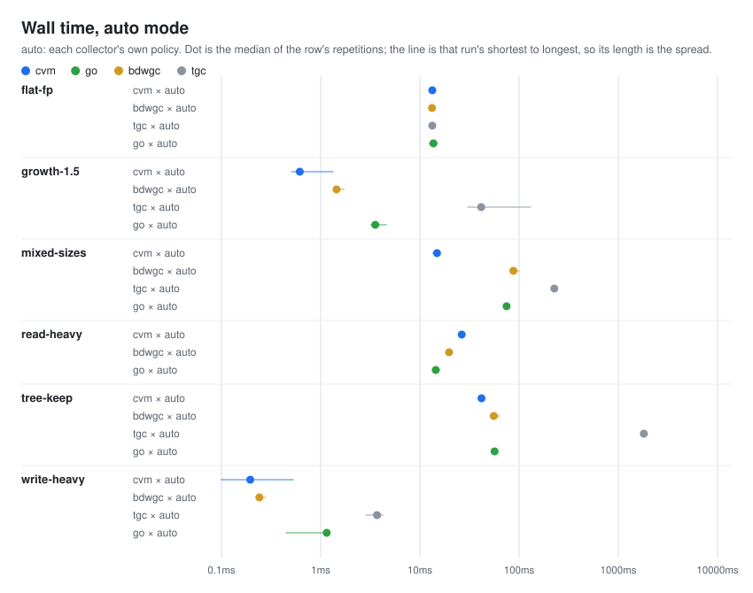
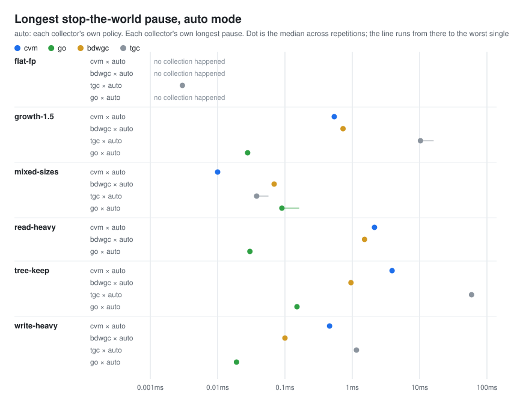
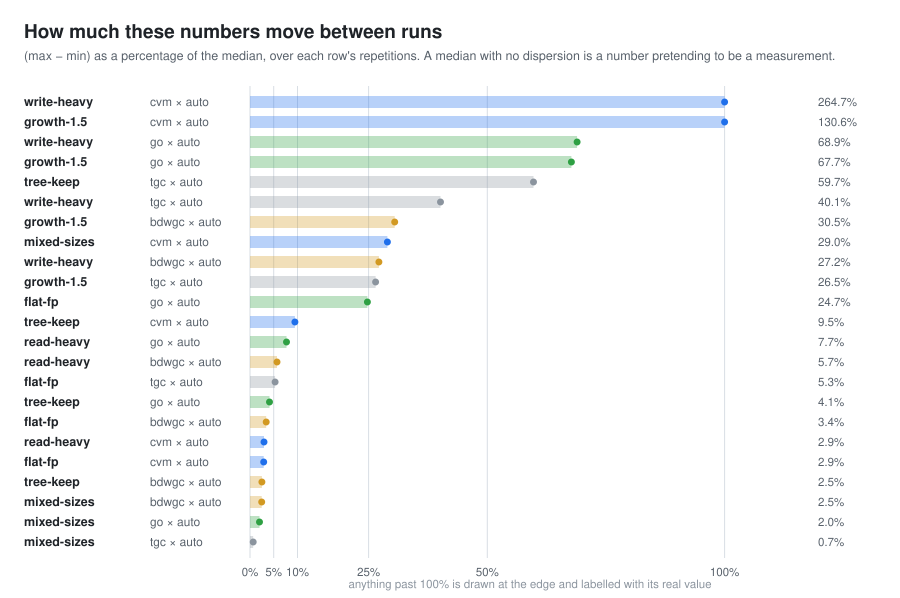

# bench — four collectors, one workload each, measured

Four garbage collectors run the same seven scenarios, compiled from the same
sources, built at the same optimization level, and land their rows in one
CSV. This file says what the numbers are and which of them not to trust.

## The four

| | marking | roots | moves objects | built as |
|---|---|---|---|---|
| **cvm** | stop-the-world, parallel | exact (frame chain) | no | the project itself |
| **bdwgc** | stop-the-world, conservative | conservative (stack scan) | no | 8.2.12, `-O1` |
| **tgc** | stop-the-world, conservative | conservative (`setjmp`) | no | 459 lines, `-O1`, three metrics added |
| **go** | concurrent, write barrier | exact | no | its own toolchain and optimizer |

Nobody moves objects — not cvm, not bdwgc, not Go, and not the Commix
reference cvm ports from. So these scenarios measure allocation, marking and
sweeping. They cannot show what a compacting or evacuating collector would do.

## What it measures

Median wall time in milliseconds. **One table per run mode, because a mode is
an experimental condition and rows from two of them are not comparable.**
alloc-only never collects, so it measures the allocator; auto lets each
collector choose, so it measures the policy.

**alloc-only**

| scenario | cvm | go | bdwgc | tgc |
|---|---|---|---|---|
| churn-unary | 24.97 | 28.67 | 27.59 | 623.70 |
| tree-keep | 49.10 | 48.25 | 51.03 | 4033.95 |
| mixed-sizes | 46.90 | 81.62 | — | 220.71 |
| flat-fp | 13.90 | 11.82 | 13.62 | 13.66 |

**auto**

| scenario | cvm | go | bdwgc | tgc |
|---|---|---|---|---|
| tree-keep | 66.86 | 54.94 | 55.01 | 1806.66 |
| mixed-sizes | 29.34 | 75.74 | 84.76 | 227.56 |
| flat-fp | 13.65 | 11.78 | 13.19 | 13.20 |
| read-heavy | 28.54 | 13.38 | 19.32 | — |
| write-heavy | 0.31 | 1.02 | 0.52 | 5.14 |
| growth-1.5 | 2.12 | 3.06 | 2.32 | 41.34 |

The full comparison is in `results/`, and the figures below are generated from
it by `pnpm run bench:svg`.

## The figures

Each is one experimental condition. They are generated, so they cannot drift
from the data.









The last one is worth reading before any of the others. Run-to-run dispersion
across these rows ranges from under 1% to over 500%, so a table of medians
presents a row that swings by a factor of six with the same confidence as one
that barely moves. In the figures, the length of a row's line is that row's
spread — which is why most rows have no visible line and a few have a long
one.

## What is missing, and why

| row | why there is no number |
|---|---|
| `read-heavy × tgc` | tgc's marker recurses once per pointer field and read-heavy's graph is a 200,000-node chain, so marking nests 200,000 frames deep. Stack overflow, in the collector this row exists to compare against. |
| `mixed-sizes × bdwgc × alloc` | a conservative collector cannot reclaim between repetitions — the scenario drops its pointers but stale copies remain on the stack — so the allocations accumulate past any heap worth reserving. |

Both are listed in `scripts/bench.mjs` under `KNOWN_GAPS` and reported as
known gaps rather than failures, because a limitation and a broken harness are
different things and a reader should not have to work out which they are
looking at.

## Running it

```
pnpm run bench:build     build every backend and binary
pnpm run bench           measure, seven repetitions
pnpm run bench:svg       redraw the figures from the latest results
pnpm run bench:all       run, then redraw
pnpm run bench:quick     three repetitions — unreliable on the small
                         scenarios; see results/README.md
```

## Where things are

| path | what |
|---|---|
| `BENCH.md` | the specification: fairness rules, scenarios, what these numbers cannot tell you |
| `harness/` | the interface every backend implements, the timing loop, the CSV |
| `scenarios/` | the seven workloads, shared by all four collectors |
| `cvm/` `bdwgc/` `tgc/` `go/` | one collector each, with its backend and a short README |
| `results/` | the run the figures are drawn from |

Each collector's folder README says what that backend can and cannot report —
they are not interchangeable, and a column one of them leaves at zero is
listed there.
